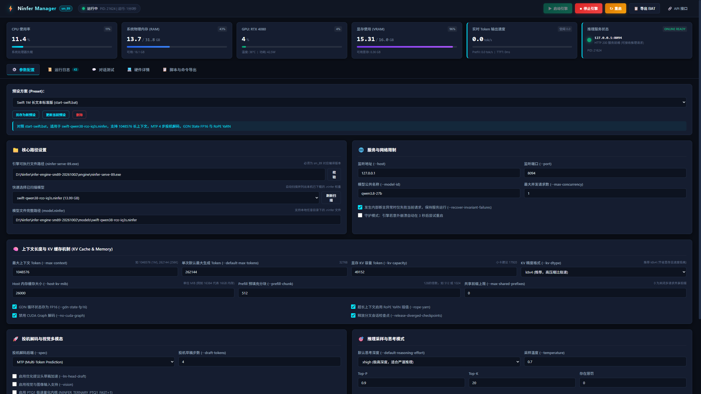
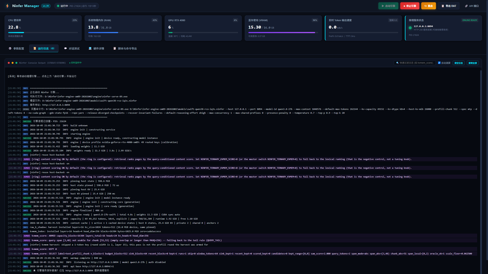
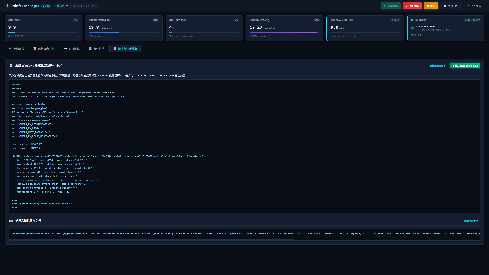
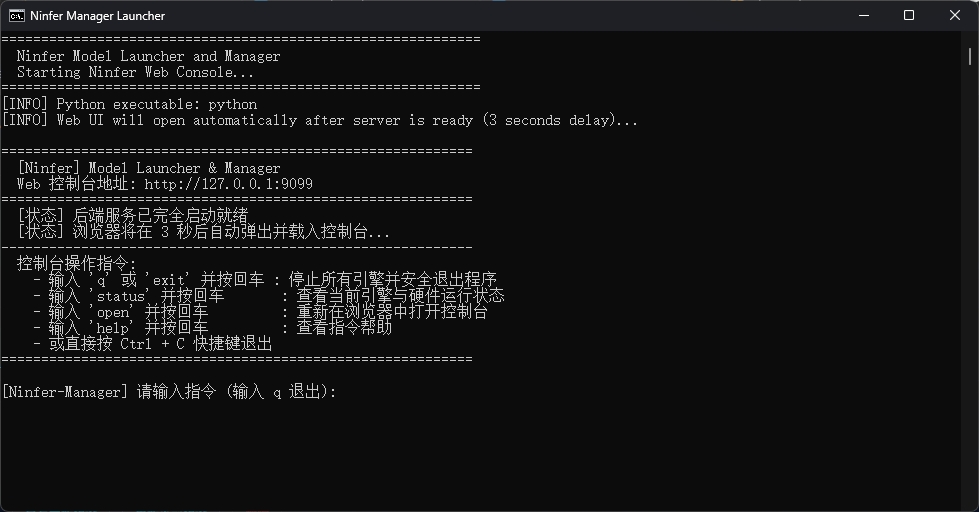

# Ninfer 模型启动器与可视化控制台 (Ninfer Manager)

专为 **Ninfer 高性能推理引擎** (`ninfer-serve-89.exe`) 设计的现代化全功能可视化模型启动器与硬件监控控制台。

---

## 📸 界面预览

### 1. 参数配置与全局硬件监控看板
集成 CPU、内存、GPU、显存实时占用、实时 Token 输出速度与模型参数可视化配置：


### 2. 实时运行日志与 KVMEM 监控控制台
通过 Server-Sent Events (SSE) 协议实时流式捕获推理引擎 STDOUT / STDERR，支持语法高亮与关键指标追踪：


### 3. Windows 批处理脚本 (.bat) 动态导出
根据界面所选参数与环境变量自动生成与官方标准完全兼容的批处理启动脚本与单行命令：


### 4. 优雅的终端控制台启动与安全交互
启动器服务就绪后自动拉起浏览器，并在终端提供交互式命令（如 `q` 退出、`status` 查看状态、`open` 重新打开网页）：


---

## 🌟 核心功能特性

### 1. 深度整合四大核心批处理预设
完整对照并收录了官方启动方案，支持一键切换与自定义扩展：
- **Swift 1M 长文本版 (`start-swift.bat`)**：支持 1,048,576 超长上下文（1M Context）、MTP 4 步投机解码、k8v4 KV 缓存、GDN State FP16 与 RoPE YaRN。
- **Swift 现存模型配置 (`Huihui-Qwen3.8-27B`)**：直接适配当前本机现有的 `models\Huihui-Qwen3.8-27B-abliterated-Swift-1.5-GSQ-RCO-IQ3_S-mtp.ninfer`。
- **PQ2 DFlash 极速多模态 (`start-pq2-dflash.bat`)**：采用 `dflash2` 投机架构，12 draft tokens，启用 `--lm-head-draft` 与 `--vision` 视觉能力。
- **PQ2 MTP 轻量/小卡模式 (`start-pq2.bat`)**：针对 16GB VRAM 显卡优化，MTP 投机解码，低显存占用。
- **PTQ1 原生 MTP 快速模式 (`start-ptq1-mtp.bat`)**：启用 `NINFER_TERNARY_PTQ1_FAST=1` 核心加速。

### 2. 全方位参数可视化调节
- **基础网络**：Host、Port、Model ID、Max Concurrency、故障自愈容错。
- **上下文与 KV 内存**：Max Context、Default Max Tokens、KV 容量、KV 数据类型（k8v4 / bf16 / fp8 / int8 等）、Host 内存缓存（host-kv-mib）、Prefill 分块大小。
- **投机加速与视觉**：投机后端（MTP / DFlash2 / DFlash / none）、Draft Tokens 步数、LM Head 提议加速、多模态视觉 Vision、PTQ1 Fast 内核。
- **采样与思考深度**：Default Reasoning Effort（xhigh / high / medium / low / none）、Temperature、Top-P、Top-K、Presence Penalty。
- **环境变量动态编辑**：可自由增删改 `NINFER_KV_WINDOW`、`NINFER_KV_RETRIEVE`、`NINFER_KV_RING`、`NINFER_HOST_PAGEABLE` 等。
- **日志杂音过滤**：原生集成 `mask hidden`、`demote-other` 等杂音过滤规则。

### 3. 实时硬件指标监控 (0 依赖，原生毫秒级响应)
无需安装庞大或兼容性不佳的第三方包，纯 Python 原生 Win32 API 与 NVIDIA SMI 驱动级调用：
- **CPU 使用率**：Win32 `GetSystemTimes` 高精度计算处理器负载。
- **物理内存 (RAM)**：Win32 `GlobalMemoryStatusEx` 实时读取已用/可用/总量（精确到 GB 与百分比）。
- **显存占用 (VRAM)**：实时读取显卡 VRAM 已用/可用/总容量及百分比。
- **GPU 核心状态**：实时显示显卡型号、GPU 核心利用率、核心温度（°C）、当前实时功耗（W）。
- **显存进程穿透**：实时列出占用显存的第三方进程（PID、程序名、显存占用量）。

### 4. 实时 Token 输出速度与生成统计
- **专属速率仪表卡片**：毫秒级展示当前模型推理生成速度（`tok/s`），生成时自动呼吸高亮。
- **多维性能指标**：同步展示 Prefill 预填充速度（`tok/s`）与首字生成延迟（`TTFT ms`）。
- **顶栏发光状态徽标**：页面顶部同步显示 `⚡ xx.x tok/s`，方便在任意页面位置快速获知模型工作状态。

### 5. 实时运行日志与控制台 (Server-Sent Events)
- 采用 HTTP SSE 协议，服务器推送日志至浏览器前端，毫秒级无延迟。
- 自动彩色语法高亮：`[INFO]`、`[WARN]`、`[ERROR]`、`[SUCCESS]` 以及特别高亮的 `[KVMEM]`（例如 `kvmem_score: SELECT`）。
- 控制台实时搜索过滤、自动滚屏切换、一键清空、复制日志。
- 底部实时展示当前引擎 PID、运行时间与完整的命令行。

### 6. 增强特色功能
- **内置对话测试 Playground**：无需打开其他第三方客户端，在控制台内即可直接向推理引擎发送测试 Prompt，支持流式打字机输出、思考链折叠（`<think>...</think>`）、实时计算生成速度（tokens/s）、首字延迟（TTFT ms）、总消耗 Tokens 与耗时。
- **一键脚本导出 (.bat)**：根据当前界面配置动态生成结构严谨的标准 Windows 批处理脚本，支持一键复制或直接下载为 `start-custom.bat`。
- **模型文件扫描器**：自动扫描并列出 `models` 目录下所有 `.ninfer` 模型，展示文件大小（GB）与修改时间，支持下拉选择或手动输入。
- **服务健康探针**：自动轮询引擎 HTTP 服务状态，就绪时变绿提示 `HTTP 200 Ready`。
- **进程守护**：支持在引擎意外崩溃时自动在 3 秒后尝试重启。

---

## 🚀 快速启动

### 方式一：双击启动脚本 (推荐)
直接双击运行项目根目录下的：
```cmd
run_launcher.bat
```
脚本将自动启动后台服务并在 3 秒内自动唤起默认浏览器打开控制台：`http://127.0.0.1:9099`。

在终端窗口中：
- 输入 `q` 或 `exit` 并按回车：**停止所有引擎并安全退出程序**
- 输入 `status` 并按回车：**查看当前引擎与系统指标**
- 输入 `open` 并按回车：**重新在浏览器中打开控制台**

### 方式二：命令行手动启动
```cmd
python server.py 9099
```
然后在浏览器中访问：`http://127.0.0.1:9099`。

---

## 📁 目录结构
```text
Ninfer-Manager/
├── server.py              # 后端服务 (硬件监控、进程管控、SSE日志、API转发)
├── presets.json           # 预设配置文件 (四大官方方案 + 本机现存模型)
├── config.json            # 启动器当前工作配置
├── run_launcher.bat       # 一键启动启动器批处理
├── README.md              # 使用说明文档 (含系统截图)
├── .gitignore             # Git 忽略配置
├── img/                   # 界面截图资源目录
│   ├── 1.png              # 参数配置与硬件监控看板
│   ├── 2.png              # 实时运行日志控制台
│   ├── 3.png              # 脚本与命令导出页面
│   └── 4.png              # 控制台启动终端窗口
└── static/
    ├── index.html         # 响应式暗色科技感前端页面
    ├── css/
    │   └── style.css      # 科技暗黑主题与玻璃拟物化样式
    └── js/
        └── app.js         # 前端数据绑定、SSE连接、测试交互逻辑
```
